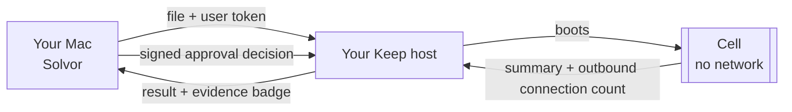

# AI docs (solvor-myrion)

_Generated 2026-10-20 by claude-opus-5-5 from a snapshot of tracked sources; verify before acting._

# Part 1: README.md

````markdown
<p align="center">
  
</p>

<h1 align="center">Solvor</h1>

<p align="center">
  <b>A native Mac client for Keep: send a file to a Keep host you run, have it read in a cell with no network,
  and see how many outbound connections that cell made.</b>
</p>

<p align="center">
  <a href="https://github.com/zyvorai/solvor/actions/workflows/ci.yml"></a>
  
  
  
</p>

<p align="center">
  
</p>

> **Status: version 0.1.0.** Local builds are ad-hoc signed and run only on the Mac that built them. A release pipeline
> exists, but signing and notarization have not yet run with real credentials. See [Install](#install) and
> [Verification status](#verification-status).

---

## What Solvor does

Solvor is a SwiftUI app plus a client library (`KeepKit`) for the [Keep](https://github.com/zyvorai/fabric) runtime.
You choose a file. Solvor uploads it to **your** Keep host and runs a *use case* on it. A use case is a host-defined
reader such as `pdf-brief`, `csv-clean` or `card-statement`. Solvor then shows the summary the host returns.

The host reads each file inside a cell with no network. Every result shows a **proof pill** with three parts:

- the number of outbound connections the cell made, as reported by the host;
- the host's evidence class (for example `software-test`);
- a warning instead of the proof when the host is a local simulator. Solvor shows **"Simulated, not sealed"**
  whenever the host reports `sealed: false` or evidence `simulated`.

### What the guarantee covers, and what it does not

The evidence class is `software-test`. The cell has no network, and the result reports its outbound connection count.
**Whoever operates the host can still read a cell's memory.** Solvor states this in Settings, in About, and in the
tooltip on every result.

## Features

| Feature | What the code does |
|---|---|
| **Many ways to start a run** | Drop files on the main window, on a use-case card, on the menu-bar item or on the Dock icon. You can also use Finder's **Services → Send to Keep**, a `keep://` link, Shortcuts or Siri. Solvor suggests a use case from the file extension, with the file name breaking ties. If several use cases fit a single file, it asks you to pick one. A dropped folder is expanded one level deep, and hidden files are skipped. |
| **Batches** | Several files go in one request and each file gets its own cell. A partial failure (HTTP 207) is shown per file and does not fail the whole batch. |
| **Use-case catalogue** | The list of use cases comes from your host (`GET /v1/demos`), so your own packs appear too. A bundled catalogue sorts known ids into groups: Documents, Phone, Mac, Windows, Developer, Browser, Office and Other. For some ids it also shows a "How to get the file" command. Solvor never runs that command; you run it yourself. |
| **Upload checks** | Before upload, Solvor checks the file name and the first 512 KB of text files. It looks for private keys, AWS, GitHub and Slack tokens, `sk-` API keys, key or password assignments, and secret-looking file names (`.env`, `id_rsa`, `.pem`, `.npmrc` and similar). Binary files are checked by name only. It also warns on files over a size you set. Any finding asks you before upload. It reports the kind of secret it found, never the value. Per-use-case size limits (`max_bytes`) are enforced before anything is sent. |
| **Read an email from your browser** | When you ask, Solvor reads the front tab of Safari, Chrome, Brave, Edge or Arc. It reads your selection if you selected more than 20 characters; otherwise it reads the page's main content. You then review and edit the subject and text. Optional redaction masks one-time codes, long digit runs (it keeps the last 4 digits) and long tracking query strings. Solvor suggests a use case, builds an RFC 822 `.eml` and runs it. Firefox is not supported. |
| **Talk to Solvor** | Speak or type a command. Speech recognition runs on the device when the language supports it, and non-English text is translated to English with Apple's Translation framework. A fixed, rule-based parser maps the text to a small set of commands. Solvor shows "I will …" and acts only after you click **Do it**. |
| **Watch folders** | Each rule has a folder, filename patterns and a use case. A matching file runs once per content hash, so renaming or touching it does not run it again. Optionally, Solvor saves the summary next to the file. |
| **Approvals** | Solvor lists approvals waiting for you. If you enrolled this Mac as a device, Solvor signs each decision with a Secure Enclave P-256 key over the exact text the host checks, and shows you that text. It checks for new approvals every 20 seconds while the app runs and sends a notification. |
| **History** | Shows the last 100 artifacts on the host. You can filter by use case, open one, or compare two using the host's own diff. |
| **Menu-bar item** | Gives you a drop zone, a count of waiting approvals, your last 3 runs, **Run the clipboard as…** (any use case that accepts `.txt`), and shortcuts to email, voice and the main window. |

## How it works



- **Token storage.** The user token is stored in the macOS Keychain. It is held under service `dev.zyvor.keep.token`,
  with access set to "after first unlock, this device only". It is sent only in the `Authorization: Bearer` header,
  never in a URL.
- **No background reading.** Browser and voice features run only when you trigger them. The browser script is fixed
  text, and nothing from a page is ever put into the script.
- **Email headers are sanitised.** Header values in the generated `.eml` have line breaks removed, so a page cannot
  inject extra headers. Body lines starting with `From ` are escaped.
- **Voice and Shortcuts cannot approve.** Neither has an approve or deny action. Asking to approve or deny by voice
  opens the Approvals screen instead.

## Requirements

- **macOS 26 (Tahoe) or later.** The UI uses the macOS 26 Liquid Glass styles (`glassEffect`, `.glass`,
  `.glassProminent`).
- **Swift 5.10 and an Xcode that includes the macOS 26 SDK** to build. CI uses the `macos-26` runner.
- **A Keep host** from [zyvorai/fabric](https://github.com/zyvorai/fabric), reachable over `http` or `https`.
  See the fabric repository for setting one up.
- **A user token for that host.** Use a user token, not the operator token.
  - The operator token is needed only once, to enrol this Mac as an approval device.
  - Solvor does not store the operator token.
- **Your user id on the host.** It is used for usage figures, approvals and the inbox.
- **Optional:**
  - XcodeGen (`brew install xcodegen`), only if you change `project.yml`.
  - `rsvg-convert` (`brew install librsvg`), only to regenerate the icon.

## Install

### Build from source (recommended today)

```bash
make run        # builds and opens Solvor (ad-hoc signed; runs on the Mac that built it)
```

`Solvor.xcodeproj` is generated from `project.yml` and committed. If you change `project.yml`, regenerate the project:

```bash
make project    # requires xcodegen
```

You can also build and test without `make`, as CI does:

```bash
swift test                                                       # KeepKit unit tests
xcodebuild -project Solvor.xcodeproj -scheme Solvor \
  -destination 'platform=macOS' CODE_SIGNING_ALLOWED=NO test     # app build + app tests
```

### Release builds (DMG)

`tools/release.sh` builds a Release `.dmg` and a `.sha256` file in `build/`. How the DMG is signed depends on how you
run it. Pushing a `v*` tag runs the **Release** workflow. Without Apple signing secrets, that workflow publishes an
**unsigned pre-release**, which Gatekeeper on other Macs will refuse unless you allow it (right-click → Open).

| Command | Result |
|---|---|
| `make dmg` | Ad-hoc signed. Runs on this Mac only. |
| `make release SIGN_IDENTITY="Developer ID Application: …" NOTARY_PROFILE=…` | Signed and notarized. |

The signing and notarization path has not yet run with real credentials. See [docs/RELEASING.md](docs/RELEASING.md).

## Quick start

1. Build and open Solvor with `make run`.
2. On first launch the Welcome sheet appears. Click **Open Settings**.
3. Under **Keep host**, enter:
   - **Address**, for example `https://keep.example.com`. For a host behind SSH, use `http://127.0.0.1:9096` with
     `ssh -L 9096:127.0.0.1:9096 you@host` running.
   - **User token**, which is saved to the Keychain.
   - **Your user id**.
4. Click **Save and connect**. When connected, Settings shows the host's Keep mode, use-case count and cell template.
5. Go to **Use cases**. Drop a file on the window, or click **Choose file…** on a card.
6. While the cell runs, the result view shows a progress animation. A cold cell takes about 15–25 seconds. The
   summary then appears with the proof pill. You can **Copy** the summary, or **Save…** it as Markdown.

## Usage

### Starting a run

| From | How |
|---|---|
| Main window | Drop files anywhere on **Use cases**. Solvor picks the best use case or asks you. |
| A use-case card | Drop files on the card, or click **Choose file…**. The card's use case is used. |
| Menu bar | Drop on the dashed zone, or use **Run the clipboard as…**. |
| Dock icon / Open With | Opening files with Solvor routes them like a drop. |
| Finder | Right-click → **Services → Send to Keep**. You may need to enable it under System Settings → Keyboard → Keyboard Shortcuts → Services. |
| URL scheme | `open "keep://run?usecase=csv-clean&path=$HOME/Desktop/test.csv"`. LaunchServices binds the scheme only for an app in `/Applications`. |
| Shortcuts / Siri | See [Shortcuts and Siri](#shortcuts-and-siri). |

When you drop several files, only those with an extension accepted by the best-matching use case are sent.

### Reading an email from the browser (⌘⇧E)

1. Open the message in Safari, Chrome, Brave, Edge or Arc. To send only part of it, select that text.
2. In Solvor, click the envelope button or press **⌘⇧E**, pick the browser, then click **Read the front tab**.
3. The first time, allow two things:
   - **macOS Automation.** When macOS asks whether Solvor may control the browser, click OK.
   - **The browser's scripting switch.**
     - Safari: **Develop → Allow JavaScript from Apple Events**. If there is no Develop menu, enable
       Settings → Advanced → *Show features for web developers*.
     - Chrome, Brave, Edge and Arc: **View → Developer → Allow JavaScript from Apple Events**.
4. Review the subject and text. Toggle redaction of **Codes**, **Long numbers** and **Tracking links**; each toggle
   shows how many matches it masks. If the text still looks like it contains a secret, a warning appears.
5. Pick a use case and click **Send to a sealed cell**.

**How the use case is suggested.** Solvor matches keywords and offers only use cases your host lists:

| Use case | Keywords about |
|---|---|
| `receivables-ageing` | invoices |
| `travel-itinerary` | trips |
| `subscription-finder` | renewals |
| `reimbursement-claims` | expense claims |

A use case is suggested only when at least two of its keywords appear. `mailbox-triage` is always offered as the
fallback, if the host has it. If none of these use cases exist on the host, the sheet tells you to deploy
`mailbox-triage`.

**Limits.** Only `http` and `https` pages can be read. The page text is capped at 200,000 characters.

### Talking to Solvor (⌘⇧V)

Open **Talk to Solvor**, choose a language, then press the microphone or type a command. Listening stops after two
seconds of silence. Solvor shows what it heard, the English translation it will act on, and an "I will …" line. It
does nothing until you click **Do it**.

Recognised commands are matched by fixed rules, not a model:

- **Read the email in my browser.** Opens the email sheet.
- **Summarise my latest download** or **…what I copied**, optionally with a use-case name.
  - "Latest download" is the newest regular, non-hidden file in Downloads; partial downloads are skipped.
  - The run still goes through the normal upload checks.
- **Show / open** approvals, runs (history), watch folders, settings or use cases.
- **What did I run last?** Opens Runs.
- **Approve or deny…** is never performed. Approvals opens instead.

Translation may need a language download on first use (System Settings → General → Language & Region →
Translation Languages).

### Shortcuts and Siri

Solvor registers these App Shortcuts:

| Action | What it does |
|---|---|
| **Summarise a file with Keep** | Takes a file and a use-case id (default `pdf-brief`). Runs the use case and returns the summary text. |
| **Read my browser email with Solvor** | Opens the email sheet. You still review the text before anything is sent. |
| **Summarise my latest download with Solvor** | Same as the voice command. |
| **Show my approvals in Solvor** | Opens Approvals. |
| **Tell Solvor** | Takes an English sentence and runs it through the same command parser as voice. |

None of these actions can approve or deny anything. Solvor must already be connected to a host.

### Watch folders

**Watch folders → Add a watched folder…** creates a rule. For each rule you set:

- **Use case**, which defaults to `pdf-brief` if the host has it.
- **File patterns.** Shell-style, case-insensitive and comma-separated, for example `*.pdf, invoice*.xlsx`. The
  default is `*.pdf`.
- **Save the summary next to the file.** On by default. For `report.pdf`, the summary is written to
  `report.keep.md`.
- **Notify when a run finishes.** On by default.

How the watcher behaves:

- Rules are active only while Solvor is running and connected.
- When a rule starts, files already in the folder are also run once.
- A file is run only after its size has held still for one second. Solvor waits up to about 30 seconds for it to
  settle.
- Dotfiles and subfolders are ignored.
- Each file content runs once per rule, even if the file is renamed.

**Caution:** a pattern that matches `.md` files will also match the `*.keep.md` summaries Solvor writes.

### Approvals

1. **Enrol this Mac once.** In **Approvals**:
   - Enter a device name, and make sure your user id is set in Settings.
   - Click **Enrol with an operator token…**.
   - Solvor creates a P-256 key in the Secure Enclave that requires the current enrolled biometrics, and sends only
     the public key to the host (`POST /v1/users/{user}/devices`).
   - The operator token is used once and is not stored.
2. **Decide.** For each waiting approval:
   - Expand **The exact text your Mac will sign** to see the `keep-approval-v1` payload.
   - Click **Approve** or **Deny**.
   - Solvor refuses to sign after the approval's signing window has passed.

> If the approval has no signing challenge, or no device name is set, the decision is sent **unsigned**. A host that
> requires device signatures will refuse it. If the app cannot create a Secure Enclave key, Approvals shows a warning
> to that effect.

### History

**Runs** lists the host's latest 100 artifacts. You can:

- filter by use case or title;
- select one run to read it;
- select two runs and click **Compare two runs** to show the host's diff as raw text.

## Configuration

### Settings (in the app)

| Setting | Default | Notes |
|---|---|---|
| Address | — | Must be an `http` or `https` URL with a host. A base path is kept, for example `https://x/api`. |
| User token | — | Stored in the Keychain. **Forget the token** removes it. |
| Your user id | — | Used for usage, approvals and the inbox. |
| Notifications | on | Notifies when runs finish and when new approvals arrive. |
| Warn before uploading files over N MB | 20 | Range 1–200. |
| Open at login | off | Uses `SMAppService`. |

### Where data is kept

| Data | Location |
|---|---|
| User token | Keychain, service `dev.zyvor.keep.token`. |
| Approval key handle | Keychain, service `dev.zyvor.keep.approval-key`. The private key itself stays in the Secure Enclave. |
| Folder rules and the run-once record | `~/Library/Application Support/Solvor/folder-rules.json` and `seen.json`. |
| Host, user id, device name, language and preferences | App user defaults. |

### Development and debug options

| Option | Scope | Purpose |
|---|---|---|
| `KEEP_DEV_HOST`, `KEEP_DEV_TOKEN` (environment) | Debug builds only | Use this host and token instead of Settings and the Keychain. `make run KEEP_HOST=… KEEP_TOKEN=…` is the documented way to pass these. |
| `-SolvorOpen email\|voice\|runs\|approvals\|folders\|settings\|about\|welcome` | Debug builds only | Open a given screen on launch. |
| `-SolvorDemoRun YES` | Debug builds only | Run a small demo CSV with `csv-clean` once connected. |
| `-SolvorDemoEmail YES` | Debug builds only | Open the email sheet with a synthetic message. |
| `KEEP_API`, `KEEP_TOKEN` | Tests | Enable the live tests against a real host. They are skipped otherwise. |
| `KEEP_DUMP_SCRIPTS=<dir>` | Tests | Write the browser AppleScripts to a directory for an `osacompile` check. |

### Host API used

These are the Keep runtime endpoints `KeepClient` calls:

| Method | Path | Used for |
|---|---|---|
| GET | `/v1/keep/status` | Connection status |
| GET | `/v1/demos` | Use-case list |
| POST | `/v1/demos/{id}` | Run (multipart, field `file`; 200, 201 or 207 are accepted) |
| GET | `/v1/artifacts?limit=` and `/v1/artifacts/{id}` | History and result bodies |
| GET | `/v1/artifacts/{a}/diff/{b}` | Compare two runs |
| GET | `/v1/inbox?user_id=` and `/v1/approvals` | Waiting approvals |
| POST | `/v1/approvals/{id}` | Decision, with optional `device_id` and `signature` |
| GET | `/v1/usage?user_id=` | Usage line in Settings |
| POST | `/v1/users/{user}/devices` | Device enrolment (operator token) |

## Development

### Layout

```
Sources/KeepKit/     client library, no UI: API client and models, Keychain token store, approval signing
                     (Secure Enclave), secret scan, folder rules, email builder / redactor / router,
                     browser script, voice command parser, use-case catalogue (CatalogData.swift is generated)
Sources/Solvor/      the SwiftUI app
Tests/KeepKitTests/  KeepKit unit tests, fixtures and opt-in live tests
Tests/SolvorTests/   app tests
Resources/           Info.plist, asset catalogue, entitlements
tools/               release.sh, export.sh, gen_catalog.py, make_icon.py
docs/                RELEASING.md, VERIFY.md, verify/webmail-test.html
project.yml          XcodeGen spec for Solvor.xcodeproj
```

### Common tasks

- `make help` lists the available targets, for example `test`, `test-kit`, `test-app`, `project`, `catalog`, `icon`,
  `dmg`, `release`, `stop` and `clean`.
- `tools/gen_catalog.py [path-to-examples/keep-agents]` regenerates `Sources/KeepKit/CatalogData.swift` from pack
  definitions. Its default path assumes the fabric repository layout.
- `tools/make_icon.py` regenerates the app icon and the menu-bar glyph. It requires `rsvg-convert`.

## Verification status

**Verified against a real Keep host with real cells:**

- connecting and listing use cases;
- single runs and batches;
- the watched-folder flow;
- the email pipeline (page text → `.eml` → use case);
- approval signing against the runtime's test vectors.

**Built but not yet verified,** because each needs your permissions or hardware:

- reading a real logged-in webmail page;
- Siri and Shortcuts registration;
- microphone, Speech and Translation;
- the Services entry;
- the `keep://` scheme;
- approving a real waiting request.

The step-by-step checklist is in [docs/VERIFY.md](docs/VERIFY.md).

**Not included:**

- a verified signed and notarized build;
- a push relay (approvals are polled every 20 seconds);
- a Share-sheet extension;
- Firefox email reading.

## Contributing

This repository is a **snapshot** of
[`integrations/macos-keep`](https://github.com/zyvorai/fabric/tree/main/integrations/macos-keep) in
[zyvorai/fabric](https://github.com/zyvorai/fabric). It is exported with `tools/export.sh`. Fabric is the source of
truth for Solvor, the Keep runtime, the API and the packs, so **please open issues and pull requests there.**
Design notes and the API mapping are in
[docs/keep/MACOS-APP.md](https://github.com/zyvorai/fabric/blob/main/docs/keep/MACOS-APP.md).

Before sending a change, run both test suites (`swift test` and the `xcodebuild … test` command above). CI runs both
on every pull request and on every push to `main`.

## License

Apache-2.0. See [LICENSE](LICENSE).
````

# Part 2: Documentation gaps I could not fill

## Missing files

- **Makefile.** I could not see it. Every `make` target listed in the README is unverified, including `run`,
  `project`, `test`, `test-kit`, `test-app`, `catalog`, `icon`, `dmg`, `release`, `stop`, `clean` and the
  `verify-page` target in VERIFY.md.
- **Debug environment variable names.** The app reads `KEEP_DEV_HOST` and `KEEP_DEV_TOKEN`. The README passes
  `make run KEEP_HOST=… KEEP_TOKEN=…`. I could not confirm that the Makefile maps one to the other.
- **`Resources/Solvor.entitlements` and `Resources/Info.plist`.** I could not see either file, so the exact
  entitlements are not confirmed.
- **`docs/dist/solvor.rb` (Homebrew cask).** Not shown.
- **Test fixtures (`Tests/KeepKitTests/Fixtures`).** Not shown.
- **Images under `docs/images/`.** Not shown. `tools/make_icon.py` writes `docs/assets/keep/solvor-icon.png` relative
  to the fabric repository root, not `docs/images/`. It is unclear how the README images are produced or kept current.

## Repository identity

- **Name and URLs disagree.** The repository is called "solvor-myrion", but the badge and links point to
  `zyvorai/solvor`.
- **I did not know the correct CI badge URL** for this repository, so I left the existing one.

## Host setup is not documented here

- **How to deploy a Keep host** (FluxVM, Linux) is not in this repository.
- **How to issue a user token** (`POST /v1/user-tokens`, scopes `read run approve`) is not in this repository.
- **How to find your user id** is not documented.
- **Token format.** The README says user tokens start with `kut1.`, but I found no confirmation in the code.
- **Which use cases a stock host provides** is not documented. `tools/gen_catalog.py` lists seven built-ins, and the
  host decides the rest. The original "60+ use cases" claim depends on which packs a host has deployed.

## Contradictions between the code and its own text

- **"Never drives other apps."** Settings says this, but the email feature drives browsers through AppleScript.
  The copy should be corrected.
- **The "Summarise a file with Keep" Shortcut skips the upload checks.** It calls `KeepClient.run` directly, so the
  secret scan and the large-file warning are bypassed. Only `maxBytes` is enforced. The comment on
  `AppState.perform` says every upload path goes through the checks, and the original README says "Solvor asks
  before it acts". It is unclear whether this is intended.
- **"Summarise my latest download" says it shows the file first, but it does not.** Its description says it "shows
  you which one". In practice it uploads at once when exactly one use case matches. You see the file name only in
  the result view.
- **Unlock method for approval signing is unclear.** The Secure Enclave key comment says signing needs biometrics
  "or the login password". The code only sets `.biometryCurrentSet`. Behaviour on Macs without Touch ID, and after
  fingerprints change, is undocumented.
- **Hard-coded version in About.** The About box says "Version 0.1". It does not read `MARKETING_VERSION`.

## Behaviour that may be a bug

- **Folder rules run existing files.** A rule runs files that are already in the folder when it starts. The original
  README only said "each new file". It is unclear whether this is intended.
- **A `.md` pattern can trigger itself.** A `*.md` rule picks up the `*.keep.md` output it writes. I only added a
  caution; whether the code should exclude these files is undecided.

## Release and distribution

- **`docs/RELEASING.md` and the README overlap.** The original README said a signed build is "not included", while a
  release pipeline exists. It is unclear which document is authoritative, and whether published releases exist yet.
- **No minimum hardware is stated** for approvals, such as Secure Enclave or Touch ID.

## Policies and data handling

- **No standalone contributing guide, code of conduct or security policy.** There is no way to report
  vulnerabilities in a client that handles credentials.
- **No privacy statement** covers what is in user defaults, how long temporary files persist (for example
  `clipboard.txt`, generated `.eml` files and intent files), or what notifications reveal.
- **The diff output format is undocumented.** The diff is shown as the host's raw JSON text.

## Fabric-specific paths that do not exist here

- `docs/VERIFY.md` refers to `scripts/keep-live-tenancy.sh` and `KEEP_POLICY_SEED`.
- `ProofPill` refers to `scripts/keep-demo-local.sh`.
- `CatalogTests` refers to `examples/keep-agents`.

These paths exist only in fabric, so the catalogue-coverage test always skips in this repository.
